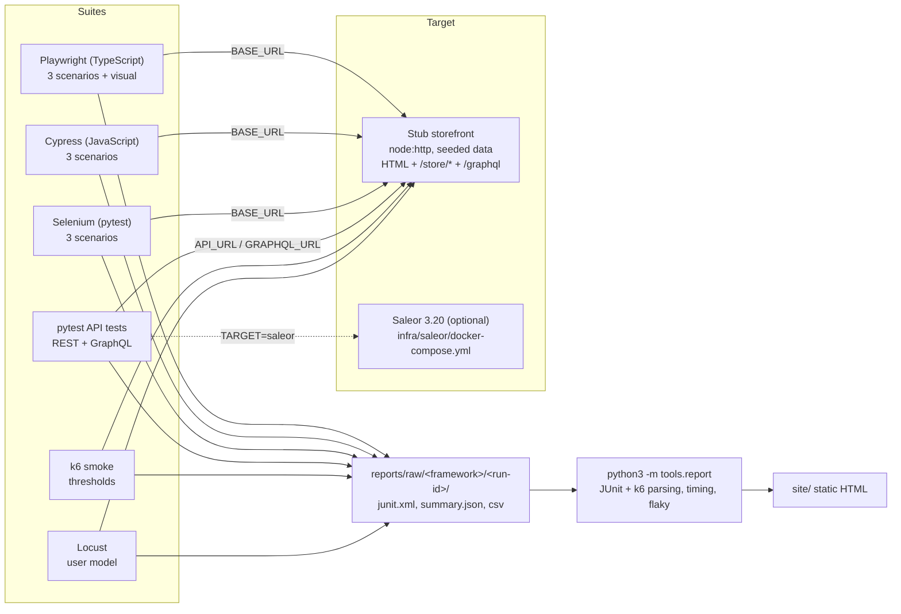

# Shopfront-QA

<!-- Status badge placeholder: replace OWNER/REPO with the real GitHub path once the repository is published. -->
[](https://github.com/OWNER/REPO/actions/workflows/ci.yml)

Licensed under the MIT License. See [WRITEUP.md](WRITEUP.md) for the project write-up.

End-to-end, API and performance test suite for a storefront. The same three shopping scenarios run through
**Playwright**, **Cypress** and **Selenium** against one local stub storefront. The suite also covers
**REST and GraphQL API tests**, **visual regression**, **k6 and Locust performance smoke tests**, and a
**stdlib-only report generator** that puts every run on one static HTML page with flaky-test detection.

The default target is a dependency-light stub (Node `node:http`, no database, no Docker). An optional
real target (Saleor 3.20 in Docker Compose) is available for the GraphQL API tests.

See [docs/design-notes.md](docs/design-notes.md) for the design notes and
[docs/](docs/) for the architecture decision records.

## Architecture



## Quick start

Requirements: Node 20 or newer, Python 3.10, and Google Chrome for Selenium. Docker is **not**
needed for the default path.

```bash
# 1. Install Node dependencies (Playwright, Cypress, graphql)
npm ci

# 2. Python environment (Selenium, pytest, requests, Locust)
python3 -m venv .venv
.venv/bin/pip install -r requirements.txt

# 3. Browser for Playwright
npx playwright install chromium

# 4. Run everything: starts one stub, runs the three UI suites, then builds the report site
#    Optional: copy tools/scripts/local.env.example to tools/scripts/local.env to set machine-specific
#    cache locations. Without it, the tools use their default cache directories.
#    run-ui-all.sh exports the cache variables only when their directory exists (see PLAN.md, section 4).
npm run test:all              # same as: bash tools/scripts/run-ui-all.sh
open site/index.html          # Linux: xdg-open site/index.html
```

Individual suites:

| Command | What it runs | Starts the stub itself? |
|---|---|---|
| `npm run test:stub` | Stub unit tests (`node --test`) | n/a |
| `python3 -m unittest discover -s tools/tests -t .` | Report generator tests | n/a |
| `npm run test:pw` | Playwright scenarios (visual tests excluded) | Yes, unless `BASE_URL` is set |
| `npm run test:visual` | Playwright `@visual` screenshot tests | Yes, unless `BASE_URL` is set |
| `npm run test:cy` | Cypress scenarios | **No.** Start the stub first (`npm run stub`) or use `run-ui-all.sh` |
| `npm run test:se` | Selenium scenarios | Yes, unless `BASE_URL` is set |
| `npm run test:api` | REST + GraphQL API tests | Yes (port 3101), unless `API_URL` is set |
| `npm run perf:k6` | k6 smoke (needs the `k6` binary) | **No.** Start the stub first |
| `npm run perf:locust` | Locust, 20 s headless (needs `.venv`) | **No.** Start the stub first |

To run the stub by hand: `npm run stub` (port 3100, health check at `/health`).

### Docker Compose (optional real target)

A single `docker compose up` is only meaningful for the optional Saleor target. It is not needed to
run the suite against the stub.

```bash
cd infra/saleor
cp .env.example .env                  # optional: placeholder values already work, and defaults apply without it
docker compose up -d                  # postgres + redis, migrate, then api on :8000
cd ../..
GRAPHQL_URL=http://localhost:8000/graphql/ TARGET=saleor npm run test:api
(cd infra/saleor && docker compose down -v)
```

The compose file has not been run in this repository: the development machine has no Docker. See
"Verification status" below.

## Configuration

Copy `.env.example` for reference. Every suite reads these variables, so any target can be used without
code changes. The values in `.env.example` are placeholders only. There are no real credentials in this
repository.

| Variable | Default | Used by |
|---|---|---|
| `BASE_URL` | `http://127.0.0.1:3100` | UI suites (Playwright, Cypress, Selenium) |
| `API_URL` | API tests: unset, so the suite starts its own stub on `http://127.0.0.1:3101`. k6 and Locust: `http://127.0.0.1:3100` | API tests; k6, Locust |
| `STUB_HEALTH_TIMEOUT_S` | `60` | Seconds the API, Selenium and `run-ui-all.sh` wait for the stub's `/health` before failing |
| `GRAPHQL_URL` | `$API_URL/graphql` | GraphQL API tests |
| `PUBLISHABLE_KEY` | `pk_test_stub` | REST `x-publishable-api-key` header |
| `TARGET` | `stub` | API tests (`saleor` skips REST modules) |
| `STUB_LATENCY_MS`, `STUB_FLAKE_RATE`, `STUB_SEED` | `0`, `0`, `42` | Stub fault injection (flaky-test and perf tests) |
| `RUN_ID` | `local` | Output folder name under `reports/raw/` |

## Scenario contract

Every UI framework implements the same three scenarios. The scenario ID is part of the test name, so
the report can line results up across frameworks.

| Scenario ID | Steps |
|---|---|
| `catalog.lists-products` | Open `/`, see 8 `product-card` items, first title is "Classic Tee" |
| `product.shows-detail` | Open `/`, click "Classic Tee", see `product-title` and price "$25.00" |
| `cart.add-item` | Open `/products/classic-tee`, click `add-to-cart`, land on `/cart`, `cart-count` is "1" |

## Repository layout

```
stub/                 stub storefront (server, GraphQL schema, seed data, node:test)
ui/playwright/        Playwright config, scenario and visual specs, darwin baselines
ui/cypress/           Cypress config and scenario spec
ui/selenium/          pytest + Selenium scenarios (Selenium Manager fetches chromedriver)
api/                  pytest REST and GraphQL tests
perf/k6/              k6 smoke with thresholds
perf/locust/          Locust user model
tools/report/         JUnit, k6, timing, flaky detection, static site renderer
tools/tests/          unittest suite and fixtures for the report generator
tools/scripts/        run-ui-all.sh (one stub, three suites, then the report)
infra/saleor/         optional Saleor compose stack
docs/                 architecture decision records (ADR-*.md)
.github/workflows/    CI workflow
```

## CI

`.github/workflows/ci.yml` runs on pushes to `main`, on pull requests, nightly (with
`STUB_FLAKE_RATE=0.05` for the UI matrix), and on manual dispatch.

| Job | Purpose |
|---|---|
| `unit` | Stub tests and report generator tests |
| `api` | pytest REST and GraphQL suite |
| `ui` | Matrix over Playwright, Cypress and Selenium, one artifact per framework |
| `visual` | Manual only (`workflow_dispatch`); needs Linux baselines first |
| `perf` | k6 smoke (thresholds gate the job) and a 30 s Locust run |
| `report` | Merges all `raw-*` artifacts and builds `site/`, uploaded as the `report-site` artifact. Runs on pull requests too |
| `deploy` | Publishes `report-site` to GitHub Pages. Runs only on pushes to `main` |

GitHub Pages must be set to **Settings > Pages > Build and deployment > Source: GitHub Actions**. Until
that is set, the `deploy` job fails on `main` and every other job still runs.

## Verification status

What was run on the development machine (macOS, Node 24, Python 3.10) during the packaging session. No timing
numbers are recorded here. The report site is the source for timings. Results from earlier sessions are not
repeated here, because they were not re-run.

| Item | Status |
|---|---|
| Stub unit tests (`node --test`) | Run, 16 of 16 pass |
| Report generator tests (unittest) | Run, 31 of 31 pass |
| API suite (pytest, REST + GraphQL) | Run, 20 of 20 pass. Re-run in the review session with the suite starting its own stub on 3101 (`API_URL` unset). On the external `/Volumes/Hazel` volume, an early review run failed at the old 10 s health check, and later runs passed (one took about 70 s overall). The health timeout is now `STUB_HEALTH_TIMEOUT_S` (default 60 s). A review run with `API_URL` pointing at an already-running stub also passed 20 of 20 |
| Selenium scenarios | Run, 3 of 3 pass. Re-run in the review session with the suite starting its own stub on 3100 (`BASE_URL` unset) |
| Playwright scenarios | **Failing in this environment.** The suite cannot open a page (`browserContext.newPage` times out). In a separate probe the `load` event never fired, while DOMContentLoaded did and 8 product cards rendered. Root cause not yet found |
| Playwright visual tests | Not re-run in this session. The repository ships darwin baselines only |
| Cypress scenarios | **Not verified.** The full pipeline hung after an Electron network-service crash |
| Full pipeline `tools/scripts/run-ui-all.sh` | **Not verified** end to end in this session, because of the Playwright and Cypress issues above |
| Locust headless smoke (20 s, stub) | Not re-run in this session |
| k6 smoke | **Not run.** The `k6` binary is not installed locally. CI installs it |
| Saleor compose stack | **Not run.** Docker is not installed locally. Only YAML structure was checked |
| CI workflow | **Not run on GitHub.** Only YAML structure was checked locally |
| Linux visual baselines | **Missing.** The repository ships darwin baselines only |

## Known gaps

- Visual baselines exist only for darwin. The `visual` CI job is manual until Linux baselines are
  committed.
- Medusa v2 has no official prebuilt image, so a Medusa target is future work and is not claimed.
- Cypress and k6 need a running stub. Only Playwright, Selenium and pytest start it on their own.
- `run-ui-all.sh` exports the cache variables (`npm_config_cache`, `PIP_CACHE_DIR`, `CYPRESS_CACHE_FOLDER`,
  `SE_CACHE_PATH`, plus `PLAYWRIGHT_BROWSERS_PATH`) only when their directory exists, and not
  unconditionally as the original spec said. Without the volume, the tools keep their defaults.
- Shard-by-spec for Cypress and Selenium is not implemented, because each framework currently has one
  spec file. Playwright sharding (`--shard`) is also not wired into CI yet.

## License

MIT. See [LICENSE](LICENSE). Copyright (c) 2026 iboondk.
